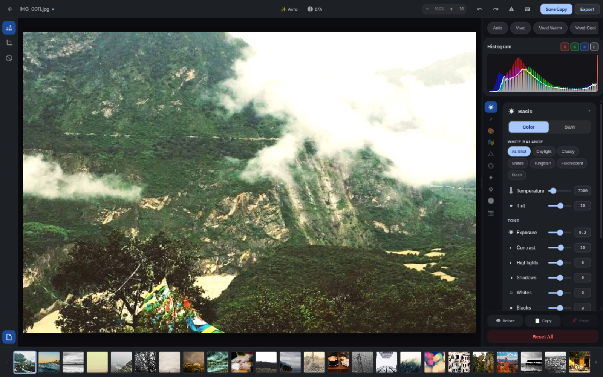
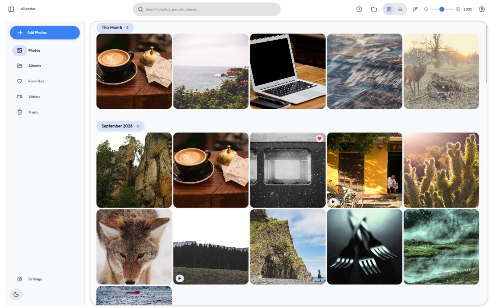
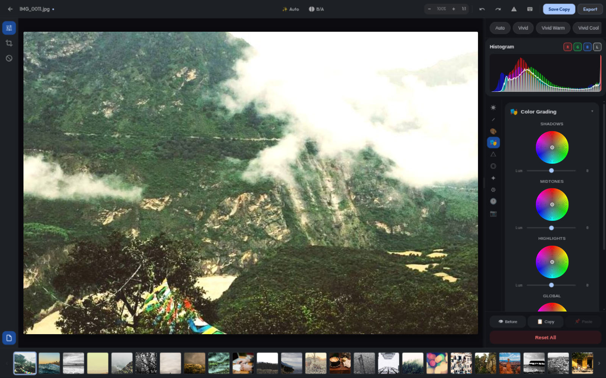

<div align="center">
  <h1>📸 Galleria Expressive</h1>
  <p><b>A student-built, Material 3 Expressive desktop gallery app.</b></p>
  <p><i>Fast, offline-first, and beautifully designed.</i></p>
</div>

<p align="center">
  
</p>

---

## 🌟 The Story

*"The main focus of this project was to learn, as I am a student."*

**Galleria Expressive** is a passion project born out of curiosity. It serves as a hands-on technical playground combining a **Tauri (Rust)** backend for native system performance with a **Svelte 4** frontend for blazing-fast reactivity. 

Aesthetically, the app is a deep dive into Google's **Material Design 3 (M3) Expressive UI**, aiming to prove that local Linux desktop apps can be just as gorgeous, fluid, and cinematic as modern web experiences.

> **🤖 Built with AI, Driven by a Human:** While AI assists heavily in generating the code, the true value of this project is the education it provides me. I am acting as the software architect—learning how frontends and backends communicate, how reactivity models work, and how complex UI/UX designs are translated into actual CSS and state logic.

---

## ✨ Features & Design

- 🎨 **M3 Expressive UI:** Imbued with 5 dynamic, tonal color palettes (Lavender, Mauve, Sage, Coral, Ocean) that beautifully tint the application's surface in both True Dark and Light modes.
- 🧩 **Tetris-Style Mosaic Grid:** An immersive, expressive viewing mode where photos of varying aspect ratios tessellate perfectly together like puzzle pieces, featuring cinematic hover effects.
- ⚡ **Offline-First & Fast:** Powered by a Rust backend and embedded SQLite, it recursively indexes your folders to extract EXIF data without ever pinging a cloud server.
- 📁 **Albums & Collections:** Fully featured intuitive album management to group your best shots.
- 🔍 **Smart Filtering:** Find exactly what you need by filtering by Year, Month, Folder, or Media Type.

## 🎛️ The Editing Engine (LightCraft)

As of v0.15, the editor runs on the [**LightCraft**](https://github.com/storytold/lightcraft) develop engine — an open-source, Lightroom-class **scene-referred, 32-bit float, wide-gamut pipeline** (linear Rec.2020 → OkLCh colour), rendered through **wgpu on the GPU** with a CPU fallback. That means:

- **Non-destructive edits** persisted as develop-settings JSON per photo: exposure, contrast, highlights/shadows, point + parametric tone curves, an 8-band colour mixer, 3-way + global colour-grading wheels, texture/clarity/dehaze, sharpening & noise reduction, lens corrections (profile + manual + defringe), vignette, grain and camera calibration.
- **Camera RAW support** — DNG, CR2/CR3, NEF, ARW, RAF, ORF, RW2 and friends (binned decodes for previews, demosaiced for exports), with real RAW thumbnails in the gallery.
- **Lightroom-grade tooling** — white-balance presets with Kelvin sliders, one-click Auto tone & white balance (scene analysis), local-adjustment masks, before/after, undo history and snapshots.
- **Exports** in JPEG, PNG, WebP and TIFF at full resolution through the same pipeline — with hard guards so an export can only ever be written beside the original photo.

| Gallery | Colour Grading |
| --- | --- |
|  |  |

---

## 🛠️ Tech Stack: The Learning Ground

- **Frontend:** Svelte 4.2 + TypeScript + Vite 7 (Migrated from React 19 to learn fine-grained reactivity and reduce bundle size by 83%).
- **Backend:** Tauri 2.0 + Rust (Learning memory safety and system-level file operations).
- **Storage:** Embedded SQLite.
- **Styling:** Custom CSS Variables built on M3 design principles (Tailwind PostCSS).

---

## 🚀 Getting Started

If you want to poke around the code or run the latest alpha build locally:

### Prerequisites
- Node.js 18+
- Rust & Cargo
- Tauri CLI (`cargo install tauri-cli`)

### Run in Development
```bash
# Install the frontend dependencies
npm install

# Fire up both the Vite dev server and the Rust backend
npm run tauri:dev
```

### Build for Production
```bash
# Compile to a highly optimized Linux binary
npm run tauri:build
# Find your executable in: src-tauri/target/release/galleria-expressive
```

---

## 📚 Vision & Roadmap

Curious about the philosophy behind the code? Check out [vision.md](./vision.md) to read about the journey, the aesthetic choices, and what I plan to learn next.
